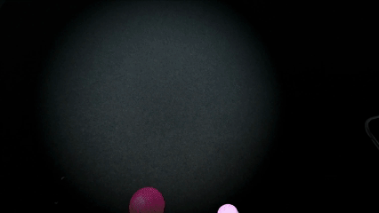

# Vergeistert

**A mixed-reality horror game for Meta Quest that turns your own darkened room into a haunted arena.**

*Vergeistert* (German for "haunted" / "spooked") was created in the course *Content Design* (summer semester 2025). The Unity project inside this repository is named `GhostbARsters`.

<p align="center">
  
</p>

> 🎬 A full gameplay recording is available in [`Docs/gameplay.mp4`](Docs/gameplay.mp4).

---

## Concept

You stand in your real room, seen through the Quest's passthrough cameras, but the lights are out. A layer of virtual darkness covers everything, and the only thing that cuts through it is the **flashlight in your hand**.

The flashlight is also your **weapon**. Hold the trigger and it fires an electro-shock beam that drives back the **dementor-like ghosts** that keep appearing around you. Ghosts slowly regenerate, and they arrive faster as time goes on, so you can't stand still.

To survive you have to keep moving and collect **mushrooms** that grow out of the floor of your room for a few seconds before sinking back into the ground:

| Mushroom | Effect | How to use it |
|---|---|---|
| **Green** | Heals you (+10 HP) | Grab it and bring it to your mouth |
| **Pink** | Recharges the flashlight (+25 energy) | Grab it and bring it to the flashlight's charger |

You start at 50 of 100 health. Fill your health bar completely to win.

### Core gameplay loop

1. **Light:** point the flashlight to see. Ghosts caught in the light cone back away.
2. **Shoot:** hold the trigger to fire the beam. Every shot uses energy and makes ghosts dissolve. A ghost that drops below its minimum health vanishes.
3. **Forage:** find mushrooms on the floor before they despawn, and eat or "feed" them to the flashlight.
4. **Survive:** ghosts spawn every 20 s at first and every 5 s after three minutes.

---

## Controls

| Action | Meta Quest Touch controllers | Editor / desktop |
|---|---|---|
| Aim flashlight | Right controller | – |
| Fire electro-shock beam | Right index trigger | Left mouse button |
| Grab mushroom | Grip button (or hand-tracking pinch/grab) | – |
| Heal | Move a green mushroom to your mouth | – |
| Recharge | Move a pink mushroom to the flashlight's charger | – |

---

## Technical Overview

### Engine & packages

| | |
|---|---|
| **Unity version** | **6000.0.47f1** (Unity 6) |
| **Render pipeline** | Built-in Render Pipeline |
| **Target platform** | Android (Meta Quest), ARM64, IL2CPP, Vulkan |
| **Min / target Android API** | 32 |
| **Meta XR SDK** | `com.meta.xr.sdk.all` 74.0.3 (Core, Interaction SDK, MR Utility Kit, etc.) |
| **OpenXR** | `com.unity.xr.openxr` 1.14.3 |
| **XR Plugin Management** | `com.unity.xr.management` 4.5.1 |
| **XR Interaction Toolkit** | `com.unity.xr.interaction.toolkit` 3.0.8 |
| **Input System** | `com.unity.inputsystem` 1.14.0 |

### Project structure

```
GhostbARsters/
└── Assets/
    ├── Scenes/SampleScene.unity     # The game scene (only scene in the build)
    ├── Scripts/                     # Gameplay logic
    ├── FlashlightEffect/            # Darkness overlay, light cone and shaders
    ├── Prefabs/                     # Ghost.prefab, Mushroom.prefab
    ├── Models/, Materials/, Sounds/ # Art and audio assets
    ├── XR/                          # XR Plugin Management and OpenXR settings
    └── Oculus/, MetaXR/             # Meta XR SDK project configuration
```

### Scripts

| Script | Responsibility |
|---|---|
| `FlashlightGun.cs` | Reads the right trigger (via `OVRInput`) or the mouse, fires a raycast 10 times per second, damages ghosts, pushes physics objects and handles energy, sound and particle effects. |
| `Ghost.cs` | Ghost AI: moves toward the player, keeps apart from other ghosts, backs off while inside the light cone, regenerates health and is destroyed below its minimum health. |
| `GhostRenderer.cs` | Creates per-instance materials and sets the `_DissolveAmount` shader property based on the ghost's health. |
| `GhostSpawner.cs` | Spawns ghosts on a circle around the player with spatial 3D spawn sounds. The spawn interval drops over time (20 s → 5 s over 180 s). |
| `Mushroom.cs` | Grows out of the floor, sinks back after its lifetime, picks a type (heal or charge), and gets "sucked into" the mouth or charger when brought close. |
| `MushroomSpawner.cs` | Spawns mushrooms at random positions within a radius, at a randomised interval. |
| `Player.cs` | Player health and the win condition. |
| `GrabManager.cs` | Plays a sound when an XR Interaction Toolkit grab interactable is picked up. |
| `PhysicsObject.cs` | Applies an impulse when an object is hit by the beam. |

### Flashlight & darkness effect

The horror atmosphere depends on making the real room dark and lighting it only where the player points:

- **`HoleEffectShader` / `DarknessOverlay.mat`:** a full-screen darkness layer drawn over the passthrough image. A soft "hole" is cut into it in the direction of the flashlight.
- **`SphereController.cs`:** passes the light direction (`_LightDir`) and edge softness (`_Smoothness`) to the darkness material every frame.
- **`LightRaycast.cs` / `ConeSize.cs`:** raycast along the flashlight so the light spot and the visible cone mesh (`ConeMesh`) adjust to the distance of the surface being lit.
- **`LightVolumeGenerator.cs`:** builds a volumetric-looking light beam from stacked quads.
- The `ConeMesh` collider is also used for gameplay: ghosts inside it switch to a larger back-off distance.

---

## XR Setup

The project uses the **OVR camera rig from the Meta XR SDK** together with the **Meta Interaction SDK** for hands and controllers.

**Scene rig (`SampleScene`):**
- `Camera Rig` (OVRCameraRig with `TrackingSpace`, eye anchors and hand/controller anchors)
- `PassthroughBackground`: shows the passthrough camera feed as the background of the scene
- Interaction SDK rigs for **controllers and hands** (`GrabInteractor`, `HandGrabInteractor`, synthetic hands)
- `Player` with a `Mouth` child (the target for green mushrooms) and the flashlight with a `Charger` child (the target for pink mushrooms)
- `GhostSpawner`, `MushroomSpawner`, `XR Interaction Manager`

**XR Plugin Management (`Assets/XR`):**

| Build target | XR loader | Purpose |
|---|---|---|
| **Android** | OpenXR, with the *Meta Quest* feature group (Meta XR Feature, Touch Controller Profile, Foveation, Subsampled Layout) | Standalone build on the headset |
| **Standalone (Windows)** | Oculus | Play mode in the Editor through Quest Link / Air Link |

**Meta XR project config (`Assets/Oculus/OculusProjectConfig.asset`):** passthrough support, hand tracking (v2), spatial anchors and scene support are enabled.

---

## Building for Meta Quest

### Requirements

- **Unity 6000.0.47f1** with the **Android Build Support** module (including OpenJDK and Android SDK & NDK Tools)
- A **Meta Quest 3 / 3S** (Quest 2 and Pro also work but only show grayscale passthrough)
- The headset in **Developer Mode** (enable it in the Meta Horizon app)
- A USB-C cable, or Quest Link / Air Link for testing in the Editor

### Steps

1. **Clone** the repository and open the `GhostbARsters/` folder in Unity Hub with Unity **6000.0.47f1**. The first import restores all packages from `Packages/manifest.json` and can take a while.
2. Open **`Assets/Scenes/SampleScene.unity`**.
3. **File → Build Profiles** (or *Build Settings*): select **Android** and click **Switch Platform**.
4. Check **Edit → Project Settings → XR Plug-in Management → Android**: **OpenXR** must be enabled, and **Meta Quest Support** must be enabled under *OpenXR → Feature Groups*.
5. Optionally run **Meta → Tools → Project Setup Tool** and click *Fix All* to apply any recommended Quest settings.
6. Connect the Quest via USB and accept the *Allow USB debugging* prompt in the headset.
7. In **Build Profiles**, select the headset under *Run Device* and click **Build And Run**. The APK is installed and started automatically.
8. Later, you can launch the game from the headset's **Library → Unknown Sources**.

> **Tip:** For quick iteration, connect the headset with **Quest Link** and press Play in the Editor. The Oculus loader for the Standalone target is already configured for this.

### Playing

- Play in a **darkened room** with enough **free floor space** (about 2 × 2 m or more). You'll be turning and moving around a lot.
- Set up the **Guardian / boundary** before you start.
- Ghosts and mushrooms start spawning about **10 seconds** after launch.

---

## Credits

Developed as part of the course **Content Design**, summer semester 2025.

Built with Unity 6, the Meta XR SDK and the Unity XR Interaction Toolkit.
